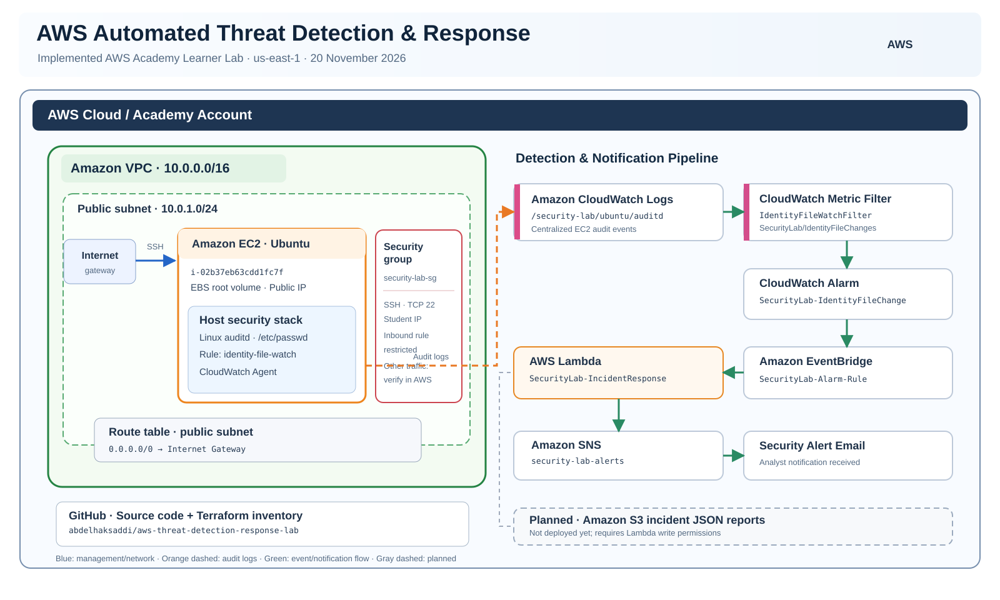
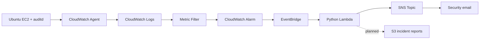

# AWS Automated Threat Detection & Response — Academic Lab

An AWS Academy lab for Linux security-event monitoring and automated email notification.

> **Status — 20 November 2026:** The live AWS resources were deployed through AWS CLI, **not Terraform**. The EventBridge-to-Lambda target is configured, and an automatic security email was reported received. S3 reporting and EC2 containment are not deployed.

## Architecture





## Existing AWS infrastructure

| Component | Resource | Status |
|---|---|---|
| Network | VPC `security-lab-vpc` (`10.0.0.0/16`), public subnet `10.0.1.0/24` | Deployed |
| Compute | Ubuntu EC2 `i-02b37eb63cdd1fc7f` | Deployed |
| Host monitoring | `auditd` identity-file watch on `/etc/passwd` | Tested |
| Log collection | CloudWatch Agent to `/security-lab/ubuntu/auditd` | Tested |
| Detection | Metric `SecurityLab/IdentityFileChanges` | Tested |
| Alarm | `SecurityLab-IdentityFileChange` | Observed OK → ALARM |
| Routing | `SecurityLab-Alarm-Rule` | Target configured |
| Handler | `SecurityLab-IncidentResponse` | Active |
| Notification | SNS `security-lab-alerts` | Email reported received |
| Reporting | S3 incident JSON | Planned |
| Remediation | Manual approval-gated containment | Planned |

## Repository layout

- `lambda/`: Python SNS alarm handler
- `auditd/`: Linux audit rule
- `cloudwatch/`: CloudWatch Agent template and detection configuration
- `terraform/`: **read-only Terraform discovery** of existing infrastructure
- `scripts/`: PowerShell inventory and Lambda test
- `docs/`: validation steps and project presentation notes

## AWS CLI + AWS Academy setup (Windows)

Follow the complete [Windows AWS CLI installation and Academy credentials guide](docs/aws-cli-setup-windows.md) before running commands. It explains how to create the local `.aws` directory, configure `credentials` and `config` with temporary Learner Lab credentials, set the `academy` profile, and test access without exposing secrets.

Use [placeholder config](examples/config.example) and [placeholder credentials](examples/credentials.example), **never real keys in GitHub**. Check the connection read-only from the project root using `.\scripts\Check-AwsAcademy.ps1`.

## Quick start

```powershell
cd terraform
terraform init
terraform validate
terraform plan
```

The Terraform `data` blocks read existing AWS resources; they **do not deploy, own, or import them**. The EC2 data lookup assumes a `Name=security-lab-ec2` tag: verify this first, because the instance was originally identified by instance ID.

## Security

- Never commit AWS access keys, session tokens, `.pem` files, Terraform state, real audit logs, or environment files.
- Keep this repository private during development.
- `chmod --reference=/etc/passwd /etc/passwd` is a harmless monitored operation, **not a real intrusion**.
- Do not automate EC2 isolation based solely on one identity-file event.

## Sources

- [AWS CloudWatch and EventBridge](https://docs.aws.amazon.com/AmazonCloudWatch/latest/monitoring/cloudwatch-and-eventbridge.html)
- [CloudWatch Logs metric filters](https://docs.aws.amazon.com/AmazonCloudWatch/latest/logs/MonitoringLogData.html)
- [AWS Lambda Python packages](https://docs.aws.amazon.com/lambda/latest/dg/python-package.html)
- [HashiCorp Terraform imports](https://developer.hashicorp.com/terraform/language/import)
- [GitHub secret safety](https://docs.github.com/en/authentication/keeping-your-account-and-data-secure/removing-sensitive-data-from-a-repository)
